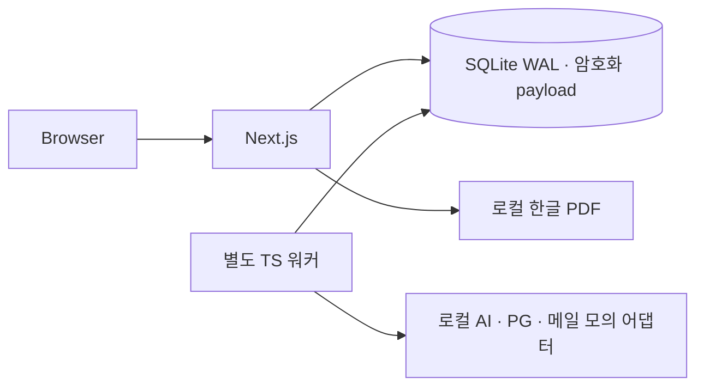

# 아키텍처 · 개발 범위

독립 Next.js App Router + TypeScript. Sites/사이트 빌더 의존성 없음. `/`는 DB·AI·세션을 읽지 않는 정적 페이지다. 최종 랜딩은 app/route.ts의 정적 HTML 응답으로 브라우저 React 런타임을 제거했다. JSX 빌드 소스/Shell을 공유하고 약0.4KB 선택적 스토리 스크립트만 보낸다. 시작은 JS 없는 기본 링크로 동작한다.

현재 구현은 **출시 불가 로컬 검증판**. PostgreSQL 권장 원안과 달리 Node 24 내장 SQLite WAL을 택해 계정 없이 지속성·트랜잭션·별도 워커를 검증한다. 단일 호스트/공유 로컬 볼륨만 지원. 다중 호스트·서버리스 배포 금지. PostgreSQL 전환/운영 검증은 출시 차단 항목이다.

계산 → 불변 암호화 스냅샷 → 무료 해석 → 인증 이메일 구매자 → 가격 고정 주문 → 모의 PG 원장 → 확인/대사 → 내구성 작업 → 암호화 보고서. 외부 네트워크 호출·실제 고객 데이터 처리 없음. 모의 PG/AI/메일을 실제 연동으로 오인하지 않도록 모든 화면에서 표시한다.

개인정보 payload는 AES-256-GCM으로 암호화, 이메일 검색은 HMAC. OTP·세션은 해시 저장. 외부 효과는 코드로 차단. 운영자 역할/MFA는 서버에서 검증하며 개발 관리자 비밀값을 하드코딩하지 않는다.
