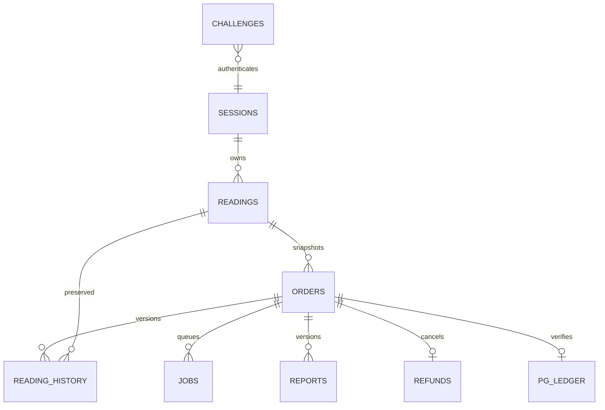

# 로컬 데이터 모델

SQLite 스키마: db/001-init.sql. FK/unique/check/부분 고유 인덱스/BEGIN IMMEDIATE/WAL/busy_timeout을 적용한다. 신규 가격은 22,000원이며 기존 33,000원 주문 보존을 위해 DB CHECK는 두 금액을 허용한다. 결제·환불은 저장된 주문금액을 대조한다. payment_key 고유, job/report는 order+version 고유, refund는 order 고유다. 모든 SQL은 파라미터 바인딩을 사용하며 사용자 문자열을 SQL로 이어 붙이지 않는다.

법정거래/개인정보 데이터는 payload/테이블로 분리하나 운영 PostgreSQL migration과 기한별 기록 파기/법적 보류·수탁 데이터 삭제는 추가 구현 필요. 현재는 SQLite 초기 스키마 idempotent migration1만 제공. 운영 migration rollback 호환성은 검증하지 않았으므로 출시 전 별도 시험한다.
