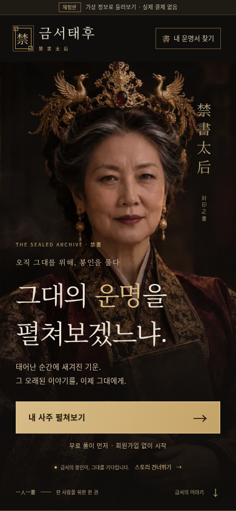
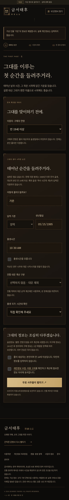

# 금서태후 Royal v2 · 화면/콘텐츠 디자인 릴리스

2026-11-14. 사용자 요청에 따라 임시 벡터를 대체하고 전 화면의 상용 디자인 콘셉트를 구현했다. **실제 판매/AI/PG/메일·운영 인프라 준비 완료를 의미하지 않는다.** 기존 운영 차단 목록을 유지한다.

## 반영
- 새 AI 창작 태후 초상. 금 봉황관/자주색 비단/촛불의 황궁,전체 화면 몰입형 랜딩.
- 차콜/버건디/앤티크 골드,명조 글꼴,세로 한자 서명,절제된 금박 테두리.
- 영상 다운로드를 기다리지 않는5초 스토리·작은 줌,즉시 CTA,건너뛰기/reduced-motion.
- 입력/무료/결제/운명서에 일관된 여정 표시·카드·표지·종이색 장문 읽기 화면.
- 고객에게 불필요한 claimIds/엔진 버전은 펼침 영역으로 옮기고 개인정보·미성년 제한·가격·환불·체험 사실 고지는 유지.
- 예시 보고서 taehou-2:장별 반복 축소,구체적 일상 제안,월별 대표 간지와 계획 제안. 미래 사건·재물 성공을 확정하지 않는다. 기존 저장된 고객 보고서는 변경하지 않는다.
- PDF도 같은 계산/본문에서 제작. 사진 표지·금박 프레임·종이색·한글400굵기 본문·페이지번호. 한글 추출과 폰트 내장 테스트.
- 공개 합성 체험판의 첫 화면에서 React 번들을 요청하지 않도록 구성. 입력·결제 체험 선택 시에만 로딩.
- 캐시된 이전 시안과 혼동하지 않도록 royal-v2 파일명/링크쿼리 사용.

## 확인한 결과
- 단위/통합/오프라인 계약191개 통과.
- Chromium모바일/WebKit모바일/데스크톱 E2E21개 통과. PDF 최종 활자 변경 이후 모바일 전체 구매/PDF/재열람/환불 경로 추가 확인.
- 공개체험 어댑터의 입력→모의인증/결제→보고서/PDF→재열람→가상문의,관리자차단 검사. 실제 개인정보 입력 불가/API네트워크전송0.
- 랜딩 axe 위반0,이미지/글꼴 정상 로드,320px넘침 없음,JS차단시 이미지·CTA 표시.
- 새 초상을 포함한 Lighthouse모바일3회:성능99/접근성100/Best Practices100,LCP1.966~1.972초,CLS0.000324. 제한된 조작 Event Timing표본75분위40ms. 실사용RUM/INP인증은 아님.

[전체 성능 보고서](performance-budget.md) · [출시 전 작업](../OWNER_ACTION_REQUIRED.md)

## 화면

[PDF 예시](royal-sample-report.pdf)

현재 공개 주소는 고정된 가상 정보 전용 체험판이다. 실제 운영 Next.js 서버·관리자·고객정보 수집·결제·AI·메일의 외부 공개/활성화는 진행하지 않는다. 법무·사업자·만세력 검수·API/인프라 개발은 별도 단계다.

## 공개 주소 최종 확인

- Pages 배포 커밋: `29b34d1c862e5545c0c250f0f47216b06343dcfa`,게시 빌드 성공.
- 실제 외부 URL에서 HTTP200,모바일 신규초상/명조폰트 정상,첫 화면 React요청 없음,axe 위반0/콘솔·자산 오류0 확인. `royal-live-landing-test.json`.
- 실제 외부 URL에서 가상 입력→인증/모의결제→운명서/PDF→재열람→가상문의·관리자제한 통과. `royal-live-preview-test.json`.
- [GitHub 독립 실행 환경의 전체 CI 성공](https://github.com/dood66625-ux/gumseotaehu/actions/runs/43454268574):타입/191개 단위·통합/빌드/21개 E2E/정적미리보기 빌드 및 흐름 검사.

