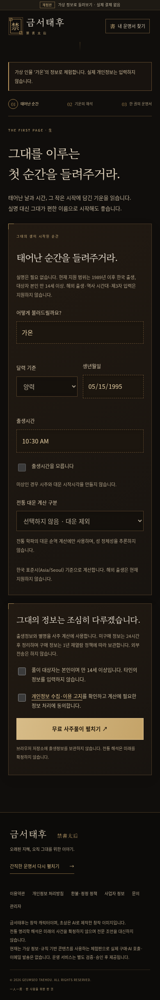

# 입력 간소화

사용자 요청에 따라 무료 풀이에서 구매자 연령·출생국가 dropdown을 제거했다. 첫 입력부터 별명·출생일·시간을 바로 표시한다. 기본 출생지역/시간대는 한국/Asia-Seoul,해외 출생 미지원 안내를 유지한다.

성인을 자동 가정하지 않는다. 미확인 상태(unconfirmed)로 무료 계산을 저장하고,결제 직전에 별도 만19세 이상 확인을 받는다. 대상자 생일만으로 구매자 성인을 인정하지 않는다. 현재 본인 풀이만 허용하므로 성인 확인과 본인 출생일이 모순되면 서버에서 거부한다. 기존 미성년 표시·만14세 미만 처리·미성년 유료 차단은 유지한다. 실제 본인/연령 인증과 법정대리인 절차의 완료를 의미하지 않는다.

검증:단위·통합194개/E2E21개/가상 공개체험 흐름 통과. 테스트에 국가·연령 생략값,성인 자동가정 방지,결제 성인동의 누락/false 거부,본인미성년 구매 우회 방지를 포함한다. 실제 결제·메일·AI·고객정보 외부 전송은 활성화하지 않았다.

[다음 운영자 준비 순서](owner-next-steps.md)
