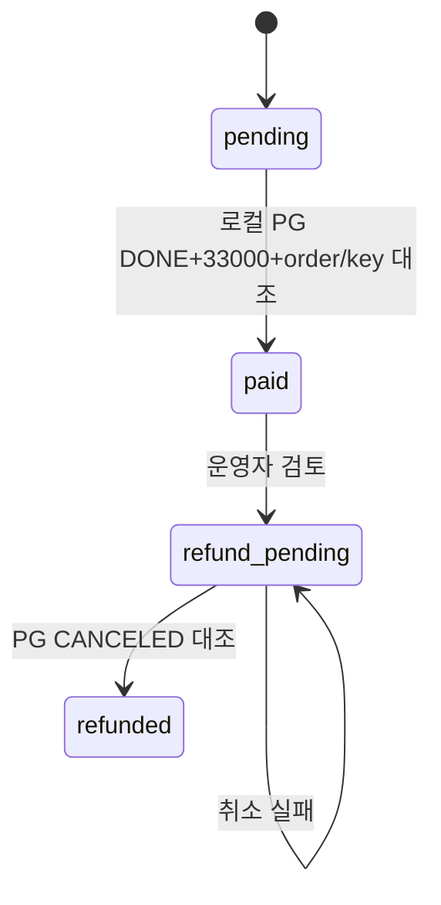

# 상태 전이

별도 fulfillment: waiting→queued→generating→ready / retrying→generating(최대4회) / failed→queued(운영자). content_deleted 별도 플래그로 유료 원문 파기 및 워커 재생성 차단. 승인된 가격은 변경하지 않는다. 보고서 수정은 입력·계산·보고서 새 version으로 제공하며 과거 이력을 보존한다.

원격 실제 PG는 없음. 로컬 원장은 앱 확정 트랜잭션과 별개라 승인 직후 앱 실패/재시작을 재현하고 reconciliation이 원장으로 복구한다. 요청 종료 후 별도 워커가 작업/대사를 수행한다.
