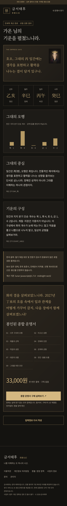

# 금서태후 검증 보고서

최신 디자인·글꼴·PDF·로딩 측정은 [Royal v2 릴리스](design-release-v2.md)와 [성능 보고서](performance-budget.md)를 참조한다.

## 최신 AI 연동 보강
타입 검사·비공개 설정 제거 후 프로덕션 빌드 및 단위/통합 **402개 통과**. 전체 E2E 30개 통과 후 배포 묶음 보강본에서 Chromium/WebKit 모바일 구매 여정 2개도 재검증했다. 현재 e2e-results.json은 이 마지막 2개 추가 검사 결과다. 합성 전용 OpenAI HTTP 경계·지속 호출 제한·비동기 보고서 저장/경합 검증을 추가했다. 실제 OpenAI 생성 요청은 HTTP 429로 실패했고 이후 호출을 중단했다. 실 AI 작성·PDF·개인화 품질을 검증 완료로 표시하지 않는다. [실제/모의 구분과 재개 조건](openai-integration.md).

## 판정
**로컬 기능 검증판, 상용 출시 BLOCKED.** 실제 AI·Toss·메일, 독립 만세력 전 범위 검수, 운영 DB·관리자 계정·성인 확인, 사업자·법률·세무 검토가 완료되지 않았다. 아래 PASS는 합성 입력과 로컬 mock에 한정한다.

## 구현·검증 단계
- 설계: architecture/decisions/assumptions/risk-register/implementation-plan/data-model/state-machine/API 문서와 SQLite migration1.
- 고객 여정: 정적 랜딩·실제 계산·개인화 무료풀이·인증·가격 고정 주문·모의 결제·보고서 저장/열람·한글 PDF·무료 재열람·문의.
- 운영: 별도 durable worker·lease/fencing·최대4회 retry·PG 원장 대사·환불 상태 대조·CS 답변·7일1회 정정·원문 삭제·비식별 CSV·감사로그.
- 보안/속도: 암호화·소유권·OTP/세션·Origin·서버 연령 게이트, 정적 root HTML로 브라우저 React 실행 제거.

## 실제 실행 결과

|검사|결과|증거|
|---|---|---|
|TypeScript strict|PASS|npm run typecheck|
|단위·통합·보안·오프라인 계약|**359 PASS**|tests/*.test.ts; 백업/콘텐츠/절입 경계 추가 포함|
|일주 독립 산술 대조|120/120 PASS|Gregorian JDN 별도 공식;120개 서로 다른 날짜|
|양음력 날짜 대조|기존 3개 + KASI 2024 초하루 12개 PASS|참고자료 일부 대조; 전 범위 검증 아님|
|절입/자시/시각 미상/윤달 오류|로컬 케이스 PASS|core.test.ts|
|모바일/데스크톱 E2E|**30 PASS**|Chromium Pixel7,WebKit iPhone13 에뮬레이션,Desktop Chromium|
|PDF 한글 추출/폰트 내장|PASS|PDF /FontFile2,/ToUnicode 및 pdftotext로 표제/장 제목 추출 확인|
|일관 백업 복구|PASS|SQLite backup을 새 연결로 열고 결제/복호화 본문 동일 검증|
|의존성 스캔|취약점0|dependency-audit.json;시점 한정|
|Lighthouse 모바일3회|Royal v2 성능99/접근성100/Best Practices100|lighthouse-1~3.json,performance-budget.md|
|실 iOS/Android/인앱브라우저|BLOCKED|기기·실 PG 앱 전환 검증 미수행|
|Docker compose 기동|BLOCKED|설정 검사 통과, 컨테이너 npm 통신 실패로 clean build/기동 미검증|

처음 E2E에서 접근성2건과 WebKit 라이브러리 누락이 발견되었다. 로고 accessible name/안내 landmark를 고치고, 공식 Debian 패키지를 작업 폴더에 추출해 실제 WebKit 실행을 확인한 후 다시 검사했다. 성능도 처음 LCP2.57~2.66초를 측정하고 구조 변경 후벡터버전0.91~1.01초,최종실사풍Royal v2약1.97초로 목표를 충족했다. 최초 실패를 최종 성공으로 숨기지 않으며 최종 원본 결과를 별도로 보관한다.

## 필수 수용 시나리오 18개

|번호|요구|판정·범위|
|---|---|---|
|1|정적 히어로/CTA·스킵·저속·reduced motion|PASS:로컬4G/JS차단/API차단. 실제 영상은 미첨부,정적대체|
|2|윤달·날짜·미상·자시·입춘·역사/해외|부분 PASS:지원범위 계산/오류 처리. BLOCKED:해외·역사·한국 전범위 대조|
|3|동일입력 일관/다른 claimIds|PASS:저장·재열람 불변,실 AI품질 BLOCKED|
|4|무료100회 남용 방어|PASS:세션20회이후 반복80회 거부,API 전역100회 제한. 운영 분산/IP방어 BLOCKED|
|5|1원·타인 주문·중복 승인|PASS:서버가격/원장/소유권,동시20요청 E2E|
|6|승인후 창닫기/재시작/DB확정실패|PASS:별도 로컬 PG원장→워커 대사. 실 PG BLOCKED|
|7|AI중단·재시도·알림/환불|PASS:합성 실패4회+audit/local안내+재처리/환불. 실 AI BLOCKED|
|8|메일 실패에도 이메일 인증 재열람|PASS:local outbox삭제후 동일원문 복구. 실제 메일 BLOCKED|
|9|한글 PDF/웹원문 동일·독립제공|PASS:실PDF내장·추출/본문 동일. 실모바일 저장 UX 추가검증|
|10|이메일 정정·타인 보고서 비노출|로컬 PASS:기존 주소 최근 인증+새 주소 OTP+세션 폐기+동일원문 재열람. 실제 메일/수동 증빙 검증 BLOCKED|
|11|14~18세 서버 차단|PASS:guardianConsent위조로도 불가. 실 성인확인 BLOCKED|
|12|법정대리인 계약취소|PASS:guardian CS분류/답변/운영 검토. 법률·실PG검증 BLOCKED|
|13|환불 중복/PG실패 상태|PASS:원장고유취소/실패pending유지. 실PG BLOCKED|
|14|환불 접근권/거래분리|PASS:완료후403;삭제원문재생성차단. 법정 보존기한 파기·법적보류 BLOCKED|
|15|광고 개인정보 금지/승인 이벤트1회|PASS:외부광고0,내부이벤트무PII·승인1회. GA4/Meta실연동 BLOCKED|
|16|임의ID/PDF·OTP/속도제한|PASS:401/403/404·5회/15분/단일사용·새브라우저복구|
|17|장애중 랜딩/기존구매지원|PASS:root DB/키/AI와독립,재열람/문의 링크|
|18|승인없는 실제외부행위 차단|PASS:외부 transport기본거부,live키거부,API local모드 강제. 실판매/메일/개인정보전송/사이트배포 없음|

## 화면 증거 (합성 고객만 사용)

### 모바일 랜딩

### 무료 계산 결과

### 보고서

### 실제 업무가 연결된 로컬 관리자

WebKit·데스크톱 스크린샷과 각 환경에서 내려받은 한글 PDF도 같은 docs 폴더에 있다. 원문에 실제 고객 데이터나 비밀값은 없다. source GitHub 저장소는 사용자 지정 `dood66625-ux/gumseotaehu`, 운영 사이트가 아니다.

입력 간소화 최신 검증:단위·통합194개/E2E21개. [변경 및 검사](input-simplification.md)를 참조한다. 과거 릴리스의191개는 그 시점 결과다.

최신 계산 경계 보강: 단위/통합 265개, E2E 24개 및 프로덕션 빌드 통과. [출처·대조 범위·남은 한계](astrology-boundary-validation.md). 앞선 194개/21개 표기는 당시 릴리스 기록이다.

최신 운영 보강: 단위·통합 295개/E2E 30개, 타입 검사·프로덕션 빌드·고정 가상 정보의 이메일 변경을 포함한 공개 체험판 테스트 통과. 관리자/고객 세션 교체·TOTP 재사용/최근 인증·작업 복구·환불 대조·서명 삭제 이력·DATA_KEY 교체/과거 키 백업 복구를 포함한다. [범위·한계](hardening-release.md). 과거 265/24개 표기는 당시 기록이다.

최신 결제 코어 보강: 전체 단위/통합 331개/E2E 30개 및 빌드 통과. TossOrderCoordinator의 DB 주문·승인·조회·취소/알림/장애 복구는 가짜 게이트웨이와 가짜 fetch로 검사했다. 실제 SDK/PG E2E가 아니다. [검증·미완료 범위](toss-order-integration.md).

메일 복구 코어 보강: 단위/통합 359개, 기존 브라우저 E2E 30개 통과. 신규 메일 큐·주소 암호화·전달 상태·반송·중복/타임아웃·인증 만료·복구 보류는 가짜 MailGateway로 검사했다. 실제 발송/수신/SMTP·공급자 API 검증은 미완료다. [범위와 남은 조건](mail-delivery-integration.md).
